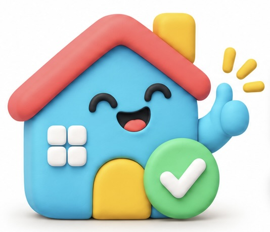

<p align="center">
  
</p>

<h1 align="center">RentBuddy</h1>

<p align="center"><strong>A CRM for renters. Track every apartment, every agent and every viewing in one place.</strong></p>

---

## Overview

RentBuddy is a CRM for renters. It pulls the listings a renter picks on Zillow and StreetEasy into one place to track them. Its core features are:

- A kanban view of every apartment the renter is considering, across listing sites
- The email threads for each listing, with the ability to send new emails in those threads
- Booking viewing times onto the renter's calendar
- Automatic filling of rental applications *(post-MVP)*

## Pricing

**$25 for a 60-day search pass.**

## Core marketing metrics

- **Speed to first contact:** time from tracking a listing to sending a viewing request
- **Viewings booked per week**
- **Agent response rate**
- **Leases signed**
- **Time to fill out a rental application** *(once application autofill ships)*

## Unique email address

Each user gets a unique RentBuddy email address. They use it to email agents and to sign up for their Zillow and StreetEasy accounts. All listing activity then flows into RentBuddy, where it's matched to the right listing.

## User flow

1. **Get an address.** The user gets their RentBuddy email address and uses it on their Zillow and StreetEasy accounts and when contacting agents.
2. **Track listings.** On any Zillow or StreetEasy listing, the user clicks **Track in RentBuddy** in the Chrome extension. A kanban card is created automatically. It shows the listing, photos, rental details (price, beds and baths, square footage, fees, availability), and the agent's name and company.
3. **Contact agents.** RentBuddy drafts a viewing request for each listing. The user reviews the draft and sends it from their RentBuddy address.
4. **Keep threads in sync.** Agent replies and emails from the listing sites are matched to the right card automatically. The user can read the full thread and reply from the card.
5. **Book viewings.** RentBuddy picks out proposed viewing times from agent replies. The user confirms a time with one click, and it's added to their calendar.
6. **Move through stages.** Cards move through the stages below, with a Passed lane for listings the user drops.
7. **Apply** *(post-MVP).* When an agent sends an application, RentBuddy fills it in from the renter's saved profile and documents.

### Kanban stages

```
Tracked → Contacted → Viewing scheduled → Viewed → Applied → Signed
                                                     ↘ Passed
```

## MVP

The Chrome extension as the way listings come in, plus a kanban that stays in sync with the renter's RentBuddy email and calendar. Application autofill comes after the MVP.

## Branding

### Colors

| Color | Hex | Use |
|---|---|---|
|  Cyan | `#46D3F1` | Primary brand, Tracked / Contacted |
|  Green | `#57D881` | Success, Applied / Signed |
|  Yellow | `#FDC214` | Attention, Viewing scheduled |
|  Coral | `#FD6865` | Passed, urgent, errors (use sparingly) |

Put these on a neutral base: near-black navy text and an off-white background. Use dark text on colored chips and buttons. White text on any of these colors fails contrast requirements.

### Typography

| Role | Font | Source |
|---|---|---|
| Headers and titles | **Sen** | [Google Fonts](https://fonts.google.com/specimen/Sen) |
| Subtitles | **Sanchez** | [Google Fonts](https://fonts.google.com/specimen/Sanchez) |
| Body | **DM Sans** | [Google Fonts](https://fonts.google.com/specimen/DM+Sans) |

```html
<link href="https://fonts.googleapis.com/css2?family=DM+Sans:wght@400;500;700&family=Sanchez&family=Sen:wght@400;700;800&display=swap" rel="stylesheet">
```

```css
h1, h2, h3 { font-family: "Sen", sans-serif; }
.subtitle  { font-family: "Sanchez", serif; }
body       { font-family: "DM Sans", sans-serif; }
```

## Development

This is a pnpm monorepo.

```
packages/
  ui/            @rentbuddy/ui: design system (tokens, fonts, React components, Ladle stories)
apps/            web app and Chrome extension (coming next)
```

```bash
pnpm install
pnpm ladle        # browse the design system at http://localhost:61000
pnpm typecheck
```

### Design system (`packages/ui`)

- **Tokens:** `src/tokens/tokens.json` is the single source of truth for colors, stage colors, fonts, type scale, spacing, radius and shadows. `pnpm --filter @rentbuddy/ui tokens` generates `tokens.css` (CSS variables prefixed `--rb-`). Never edit `tokens.css` by hand.
- **Fonts:** self-hosted through Fontsource. Import `@rentbuddy/ui/fonts.css` once per app.
- **Base styles:** `@rentbuddy/ui/base.css` loads the tokens and sets the page background, body font and focus ring.
- **Components:** `Logo`, `Heading` / `Subtitle` / `Text`, `Button`, `StageBadge`, `ListingCard`, `KanbanColumn`. Every component has a Ladle story next to it (`*.stories.tsx`).
