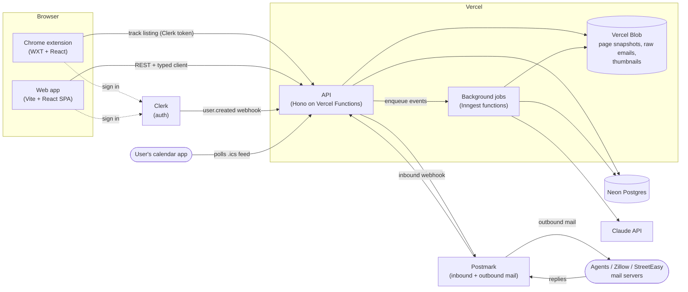
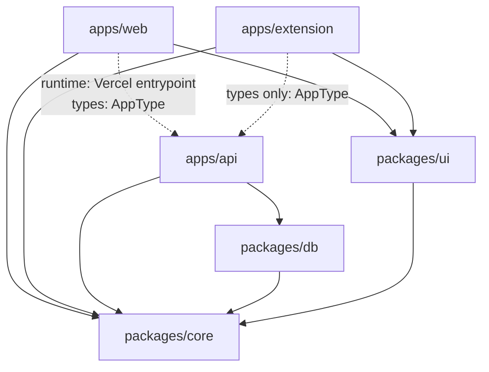
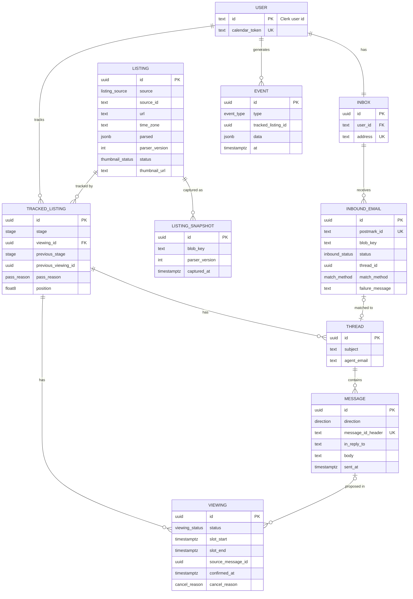
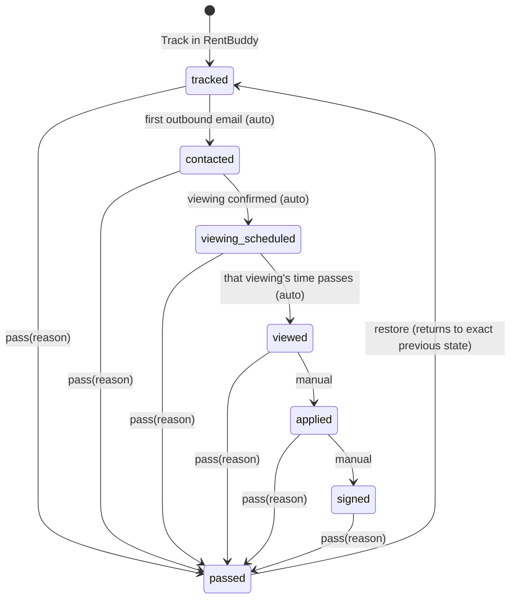
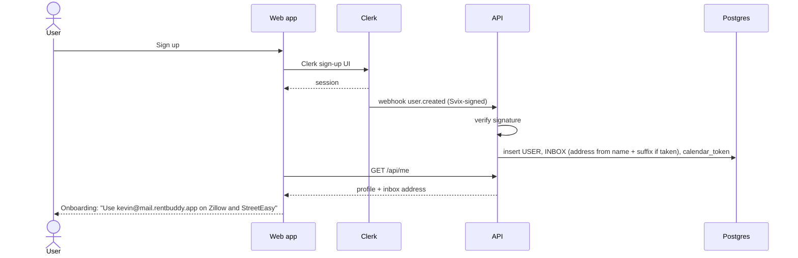
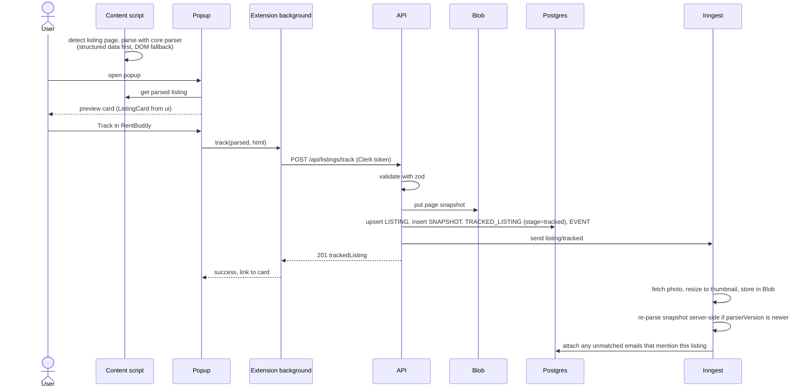
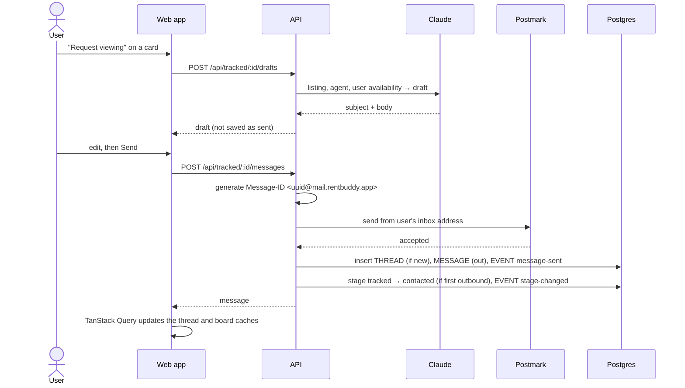
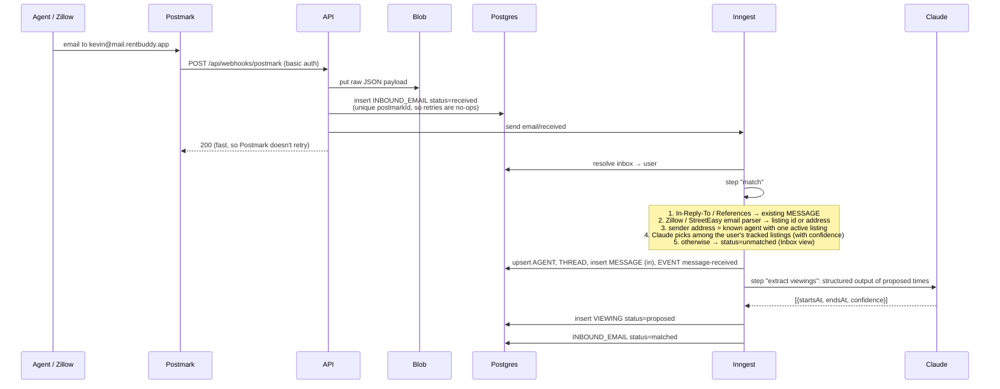
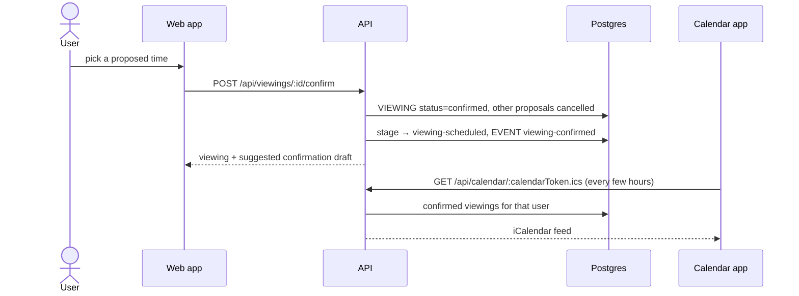

# RentBuddy architecture

This document describes how RentBuddy is put together: the systems, the code layout, and how a request flows through them. Update it in the same PR as any change that alters a flow described here.

**Principles:** [parse, don't validate](principles.md) — read it first.

**Stack:** TypeScript everywhere · pnpm + Turborepo · Vite + React · TanStack Router + Query · Hono on Vercel Functions · Clerk · Postmark · Neon Postgres + Drizzle · Inngest · Vercel Blob · Claude API · WXT (Chrome MV3)

---

## 1. System overview



**Principles**

1. **The web request path stays fast and thin.** Webhooks and user actions validate, write the minimum, enqueue a job and return. Anything slow or flaky (LLM calls, image fetching, email matching) runs in Inngest, where every step is retried and idempotent.
2. **Keep the raw input.** Every captured page and every inbound email is stored unmodified in Blob before it is parsed. When a parser improves, we re-run it over stored data rather than asking users to redo anything.
3. **Domain logic is pure.** Parsing, matching rules, the stage state machine and metric calculations live in `packages/core`, which does no I/O. They're easy to unit test and are shared by the extension, the API and jobs.
4. **Every query is scoped to a user.** Repository functions take `userId` as a required argument. There is no "get listing by id" without an owner.

---

## 2. Repository layout

```
apps/
  web/
    src/                    Vite + React SPA
      routes/               TanStack Router file routes
      features/             board/, listing/, inbox/, settings/ — components + query hooks per feature
      lib/                  api client, query client, clerk setup
    api/
      [[...route]].ts       Vercel entrypoint: two lines that hand every /api/* request to @rentbuddy/api
  api/                      Hono backend (Vercel Functions in prod, Node in dev); exports `AppType`
    src/
      app.ts                composes routes, exports the app and `type AppType`
      routes/               listings.ts, messages.ts, viewings.ts, calendar.ts, webhooks/
      services/             business logic: TrackService, MailService, ViewingService…
      jobs/                 Inngest functions
      middleware/           auth (Clerk JWT), error handling, request logging
      dev.ts                local Node server
  extension/
    entrypoints/
      popup/                React popup: preview card + "Track in RentBuddy"
      zillow.content.ts     content script for zillow.com listing pages
      streeteasy.content.ts content script for streeteasy.com listing pages
      background.ts         service worker: auth token, API calls
packages/
  core/                     pure TypeScript, no I/O
    src/primitives.ts       branded ids, Money, EmailAddress, TimeSlot…
    src/listing.ts          ParsedListing, Bedrooms, PageParseResult
    src/stage.ts            StageState union + transition functions
    src/viewing.ts          Viewing union
    src/inbound-email.ts    InboundEmailState, MatchMethod
    src/event.ts            DomainEvent union
    src/result.ts           Result, ok, err, assertNever
    src/parsers/            zillow.ts, streeteasy.ts (+ fixtures and tests)   (next)
    src/mail/               address format, thread-matching rules           (next)
    src/metrics.ts          metric definitions over DomainEvent             (next)
  db/                       Drizzle schema, migrations, client factory, repositories
  ui/                       design system (done)
```

**Dependency rules** (enforced with lint rules later):



- `core` depends on nothing internal, and does no I/O.
- The web SPA and the extension import **only the type** `AppType` from `apps/api` (`import type`), never its runtime code. The one exception is the two-line Vercel entrypoint in `apps/web/api/`.
- Only `apps/api` imports `db`. Clients only talk to the API over HTTP.

### Server layering

```
Hono route        validates input with core zod schemas, reads userId from auth
   │
   ▼
Service           business logic; the only layer that enqueues jobs or calls Postmark/Claude
   │
   ▼
Repository (db)   Drizzle queries, always scoped by userId
```

Inngest jobs call the same services as routes, so logic isn't duplicated between the request path and background work.

### Shared types and validation (zod)

This repo follows [parse, don't validate](principles.md). There is one contract, written once as zod schemas in `packages/core/src`, and three things derived from it:

1. **Parsing at every boundary.** The API parses request params, query and body (`@hono/zod-validator`) and parses its own responses before sending. Clients parse responses again on arrival, because the network is a boundary too. The extension parses pages into a `PageParseResult`. Inngest jobs parse event payloads. Postmark and Clerk webhook bodies are parsed before use. Database rows are parsed by `fromRow` functions.
2. **Static types.** `type X = z.infer<typeof X>`. No hand-written duplicate interfaces. Branded types (`ListingId`, `Money`, `EmailAddress`…) can only be obtained by parsing.
3. **End-to-end typed calls.** Hono infers each route's input type from its validators. The SPA and the extension use `hc<AppType>()` for typed requests, and parse responses with the matching core schema to turn wire types (ISO strings, plain numbers) back into domain types (`Date`, `Money`).

Database tables (Drizzle) are deliberately **not** the API contract. Repositories map rows to core types, so a column rename doesn't change the API and internal fields never leak.

```ts
// packages/core — the contract
export const TrackListingInput = z.object({ parsed: ParsedListing, html: z.string().max(5_000_000) });
export type TrackListingInput = z.infer<typeof TrackListingInput>;

// apps/api — parsed in, parsed out; expected failures are Result values
export const listings = new Hono<AppEnv>()
  .post("/track", zValidator("json", TrackListingInput), async (c) => {
    const result = await trackService.track(c.get("userId"), c.req.valid("json"));
    if (!result.ok) return errorResponse(c, result.error); // exhaustive switch over error kinds
    return c.json(TrackedListing.encode(result.value), 201);
  });

// apps/web — typed request, parsed response
const res = await api.listings.track.$post({ json: input });
const tracked = TrackedListing.parse(await res.json()); // Date and Money again, not strings and numbers
```

### Local development

| Process | Command | Port |
|---|---|---|
| Vite SPA | `vite` | 5173, proxies `/api` to 8787 |
| Hono API | `tsx watch src/dev.ts` in `apps/api` (via `@hono/node-server`) | 8787 |
| Inngest dev server | `inngest-cli dev` | 8288 |
| Extension | `wxt` (loads unpacked into Chrome with hot reload) | – |
| Ladle | `ladle serve` | 61000 |

`pnpm dev` starts all of them through Turborepo. Postmark inbound is tested locally by replaying saved webhook payloads (`pnpm --filter @rentbuddy/api replay-email fixtures/…`), so a tunnel isn't needed day to day.

---

## 3. Data model



Column types like `stage`, `viewing_status` and `pass_reason` are **Postgres enums generated from the core `as const` lists** (`STAGES`, `PASS_REASONS`, …), so the database and TypeScript can't disagree about which values exist.

### Each table stores a union, and the database enforces it

Every table with a status column stores a core discriminated union. `CHECK` constraints tie each status to the columns that state requires, so an impossible combination can't be written even by a buggy query. Repositories read rows through a `fromRow` parser that returns the core union.

| Table | Core union | Constraints (abridged) |
|---|---|---|
| `tracked_listing` | `StageState` | `viewing_id IS NOT NULL` ⇔ `stage IN ('viewing-scheduled','viewed')`; `pass_reason`, `previous_stage` non-null ⇔ `stage = 'passed'`; `previous_stage <> 'passed'` |
| `viewing` | `Viewing` | `confirmed_at IS NOT NULL` ⇔ `status = 'confirmed'`; `cancel_reason IS NOT NULL` ⇔ `status = 'cancelled'`; `slot_end > slot_start`; partial unique index: at most one `confirmed` viewing per tracked listing |
| `inbound_email` | `InboundEmailState` | `thread_id`, `match_method` non-null ⇔ `status = 'matched'`; `failure_message` non-null ⇔ `status = 'failed'` |
| `listing` | `Listing["thumbnail"]` | `thumbnail_url IS NOT NULL` ⇔ `thumbnail_status = 'ready'` |
| `event` | `DomainEvent` | `type` is an enum; `data` is parsed through the `DomainEvent` union on every read |

### One source of truth

- `LISTING` is shared: two users tracking the same apartment share one row (unique on `source, source_id`). Everything user-specific hangs off `TRACKED_LISTING`.
- The agent is part of `LISTING.parsed` (what the page said) and `THREAD.agent_email` (who we're actually talking to). There's no separate `AGENT` table to drift out of sync.
- Facts derivable from other rows aren't stored: "first contacted at" comes from `EVENT`, unread counts come from `MESSAGE`, a column's count comes from its cards.
- **The one deliberate denormalization:** `tracked_listing.stage` is a fast projection of `stage-changed` events. Only `StageService.transition` writes either one, in a single transaction (see [principles §5](principles.md#5-one-source-of-truth)).
- `position` is a fractional index, so reordering a card within a column updates one row.
- Every listing has an IANA `time_zone`. Viewing times are stored as UTC instants and always displayed in the listing's time zone, so a renter browsing from another city sees the time the agent meant.

---

## 4. Stage state machine

Defined once in `packages/core/src/stage.ts` as the `StageState` union plus pure transition functions (`moveTo`, `pass`, `restore`, `autoAdvance`). The API uses them to decide, the board uses them to allow or block drops, and jobs use them for automatic moves.



What the types guarantee:

- **You can't be "viewing scheduled" or "viewed" without a viewing.** Those states carry a `viewingId`. Dragging a card there manually asks for the time, which creates a viewing with source `entered-by-user`.
- **Passed remembers exactly where it came from.** `{ stage: "passed", previous: ActiveStageState, reason: PassReason }`, so `restore` is exact and `passed` can't nest inside itself.
- **Transitions return `Result`s.** `moveTo`, `pass` and `restore` return `Result<StageState, TransitionError>`. `autoAdvance` returns `{ kind: "advanced" } | { kind: "unchanged", reason }`, so a skipped move says why.
- **Automatic moves only go forward** and never touch a passed listing. Only the viewing a listing is scheduled for can mark it viewed.
- **Every transition records its cause:** `stage-changed` events carry `cause: { kind: "user" } | { kind: "automatic", trigger }` instead of an `auto: boolean`.

---

## 5. Execution flows

### 5.1 Sign-up and inbox provisioning



If the webhook hasn't arrived yet when the app first calls `/api/me`, the API creates the user on demand (same code path, idempotent on Clerk user id).

### 5.2 Track a listing (extension)



- **Auth in the extension:** `@clerk/chrome-extension` shares the session with the web app, so a user signed in on the site is signed in to the extension. The background worker attaches the token to API calls.
- **Idempotency:** tracking the same listing twice returns the existing card.
- **Photos:** the listing keeps the source site's photo URLs for the full gallery. Only one small thumbnail per listing is stored.

### 5.3 Draft and send a viewing request



Nothing is sent without the user pressing Send. The draft endpoint never writes to Postmark.

### 5.4 Inbound email



- Each `step` is retried independently by Inngest, so a Claude timeout doesn't re-run matching.
- Matching that relies on Claude below a confidence threshold goes to **Unmatched** with a suggestion, rather than silently attaching to the wrong card.

### 5.5 Confirm a viewing and the calendar feed



The calendar token is a long random secret per user that can be regenerated in settings. It's the only unauthenticated read endpoint.

### 5.6 Metrics

All metrics are queries over `EVENT`, defined in `packages/core/metrics.ts`:

| Metric | Definition |
|---|---|
| Speed to first contact | `first message-sent.at − listing-tracked.at`, per tracked listing |
| Viewings booked per week | count of `viewing-confirmed` per user per ISO week |
| Agent response rate | tracked listings with ≥1 `message-received` after a `message-sent` ÷ tracked listings with a `message-sent` |
| Leases signed | `stage-changed` to `signed` |
| Time to fill an application | post-MVP |

---

## 6. Web app data flow

- **Routes** (`src/routes`): `/board`, `/listing/$id`, `/inbox` (unmatched email), `/settings`, `/onboarding`. Each route's `loader` calls `queryClient.ensureQueryData(...)`, so data starts loading during navigation.
- **Query keys** come from one factory per feature (`listingKeys.all`, `listingKeys.detail(id)`), so invalidation is consistent.
- **Mutations** that the user sees immediately (moving a card, confirming a viewing) update the cache optimistically and roll back on error.
- **Freshness:** the board and open threads refetch on window focus and every 30 seconds while visible. Server-sent events can replace polling later without changing components, since they'd just invalidate the same query keys.
- **API client:** Hono's typed client (`hc<AppType>`) gives end-to-end types from route definitions to components with no code generation.

---

## 7. Security and reliability

| Concern | Approach |
|---|---|
| API auth | Clerk JWT verified in Hono middleware; `userId` comes from the token, never the request body |
| Webhooks | Clerk: Svix signature check. Postmark: basic auth on the webhook URL plus payload validation |
| Data isolation | repositories require `userId`; integration tests assert cross-user reads fail |
| Duplicate deliveries | unique keys on `postmarkId`, `messageIdHeader`, `(source, sourceId)`; Inngest event ids |
| Mail reputation | separate `mail.` subdomain, SPF/DKIM/DMARC, no unreviewed sends, outbound rate limit per user |
| Parser breakage | parser tests on saved pages; `parserVersion` on every listing; nightly job re-parses snapshots after a parser release |
| Secrets | Vercel environment variables only; nothing in the extension bundle except the Clerk publishable key and API URL |

---

## 8. Open questions

- **Extension surface:** popup only, or also a button injected next to the listing's own "Contact" button? (The injected button is more discoverable but breaks more often when sites change.)
- **Availability for drafts:** ask the user for weekly availability in settings, or read free/busy from Google Calendar (needs OAuth)?
- **Unmatched inbox:** should Zillow marketing and alert emails be filtered out entirely, or kept in a collapsed section?
